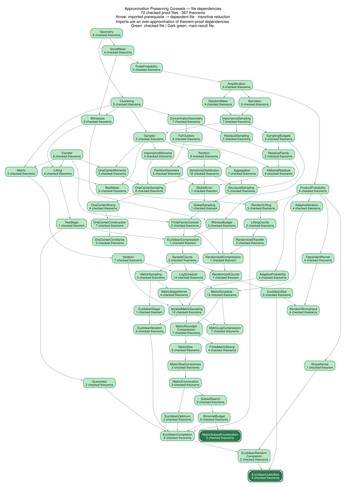

# Approximation Preserving Coresets

Lean 4 formalization of approximation-and-size guarantees from
**Approximation Preserving Coresets**, by Milind Prabhu, Chris Schwiegelshohn,
and Sudarshan Shyam.

[Paper](https://arxiv.org/abs/2606.17316) · [Formalization notes](FORMALIZATION.md)

The development contains **367 checked theorems across 72 proof files**.
It proves an unconditional Euclidean `(1+ε)` APC with an inverse-cubic size
bound up to a logarithmic factor, randomized lifting guarantees, and a
finite-metric `(4+ε)` construction with subset enumeration.

The Euclidean proof uses an alternative iterative sampling construction.
The paper’s original fast two-stage implementation, near-linear preprocessing,
full runtime analysis, lower bounds, and composability are outside the
verified scope. See the formalization notes for exact hypotheses and claims.

## Explore the proof

View the [interactive dependency graph](https://milind-prabhu.github.io/approximation-preserving-lean/).
Select a file or search for a theorem to inspect its Lean statement and source.
The route menu separates the Euclidean, metric, and original two-stage arguments.

[](https://milind-prabhu.github.io/approximation-preserving-lean/)

Arrows show **file imports**, not kernel-level theorem dependencies.
The graph is tied to the audited source hashes; checked conditional statements
remain conditional. [Graph notes and downloads](dependency-graph/README.md).

## Build and verify

Install [elan](https://github.com/leanprover/elan), clone this repository, and run:

```bash
bash bootstrap.sh
bash check.sh
```

Lean is pinned to **4.24.0** and mathlib to commit
`f897ebcf72cd16f89ab4577d0c826cd14afaafc7`. The check builds the full project,
audits all named theorems, rejects unexpected axioms, and checks the original
source hashes. [Build status](https://github.com/milind-prabhu/approximation-preserving-lean/actions/workflows/lean.yml).

The graph is self-contained and can also be opened offline from
`dependency-graph/apc-dependency-graph.html`.
